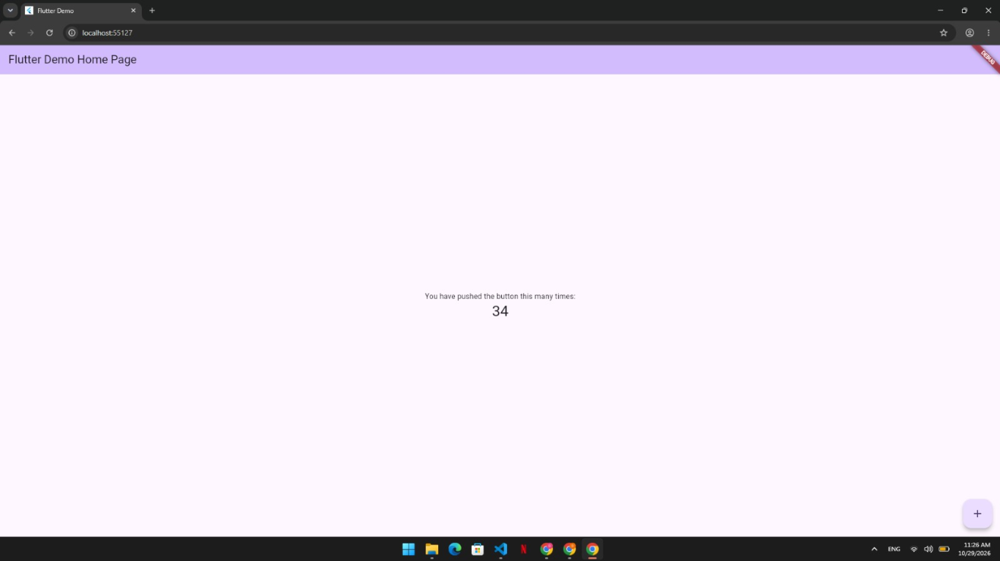
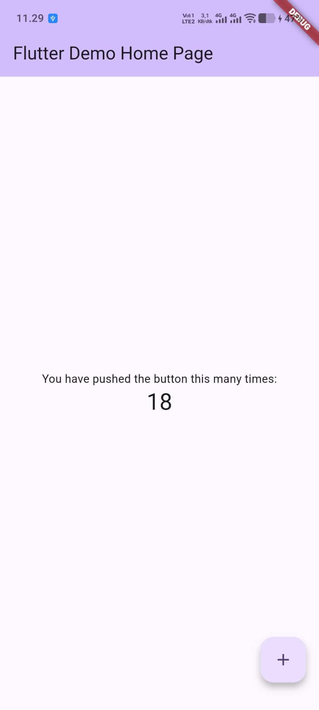

# 🎓 Aplikasi Kampusku


## 👥 Kelompok 8

| Nama | NIM |
|---|---|
| Dafa Irsyad Nashrullah | 24552011306 |
| Danny Ahmad G | 24552011168 |
| David Azhar Juli Nurbani | 24552011309 |
| Muhammad Fathal Mustaqim | 24552011225 |

## 📱 Tangkapan Layar

Aplikasi berhasil dijalankan pada dua target berbeda: Chrome dan perangkat Android.

<table>
  <tr>
    <th>Chrome</th>
    <th>Android (HP)</th>
  </tr>
  <tr>
    <td align="center" valign="top">
      
    </td>
    <td align="center" valign="top">
      
    </td>
  </tr>
</table>

## ✅ Analisis

Pemeriksaan `flutter analyze` berhasil tanpa peringatan maupun masalah:

```text
No issues found!
```
